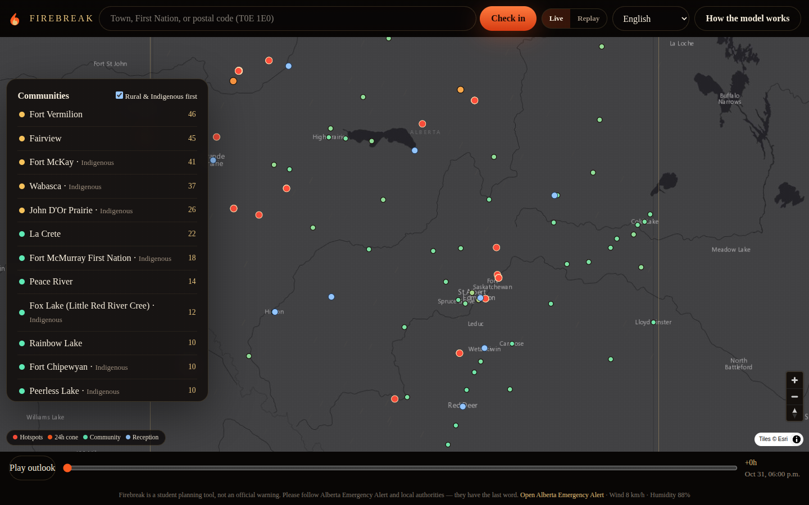
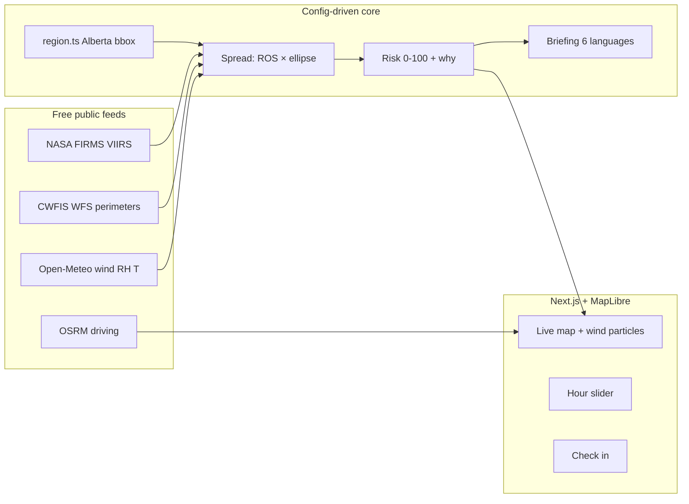

# Firebreak

**See what's ahead, and look after each other.**

A web app that tells any Alberta community how much wildfire danger it is in over the next 24 hours, why that score exists, and which roads still look like roads. Built as a solo STEMergent Hacks 2026 entry by a SAIT Software Development student in Calgary.

Firebreak is a planning companion, **not** an official warning. Please follow [Alberta Emergency Alert](https://www.alberta.ca/alberta-emergency-alert) and local authorities — they have the last word.

**Live:** [firebreak-eight.vercel.app](https://firebreak-eight.vercel.app) · Jasper replay: [/?mode=demo&view=map&q=Jasper](https://firebreak-eight.vercel.app/?mode=demo&view=map&q=Jasper)



## Why this exists

Alberta already has excellent operational tools (Alberta Wildfire status, CWFIS, FIRMS). None of them put **live fire + wind + a 24-hour spread cone + a scored escape route** on one screen a resident can read in the language they actually speak.

That gap is not abstract:

| Event | What happened | Source |
| --- | --- | --- |
| **2016 Horse River / Fort McMurray** | Spotted ~2 ha on 1 May, in town by 3 May. ~88,000 people left Wood Buffalo. Final size **589,552 ha**. KPMG/AEMA counted **1,958** structures lost or damaged. | [Alberta review](https://open.alberta.ca/publications/a-review-of-the-2016-horse-river-wildfire); [KPMG PIA](https://open.alberta.ca/publications/may-2016-wood-buffalo-wildfire-post-incident-assessment-report) |
| **2023 season** | **2,214,957 ha** burned in Alberta (10× the five-year average). **38,000+** people evacuated from **48** communities. Canada: worst season on record, **>15 million ha**. | [CBC / Government of Alberta](https://www.cbc.ca/news/canada/calgary/as-alberta-s-record-fire-season-ends-planning-begins-for-next-year-s-fight-1.7018764); [Public Safety Canada](https://www.publicsafety.gc.ca/cnt/trnsprnc/brfng-mtrls/prlmntry-bndrs/20250130/04-en.aspx) |
| **2024 Jasper** | Lightning, evening of **22 July**. **>20,000** evacuated. Fire reached town **24 July**. **358 of 1,113** structures destroyed (~30%). Contained at **32,700 ha**. | [Parks Canada](https://parks.canada.ca/pn-np/ab/jasper/visit/feu-alert-fire/feudeforet-jasper-wildfire); [Recovery Framework](https://parks.canada.ca/pn-np/ab/jasper/gestion-management/serviceimmobilier-realty/retablissement-recovery/cadre-framework) |
| **2024 Alberta season** | **>1,210** fires, **>705,000 ha**, including Little Red River Cree Nation evacuations. | [CBC / Alberta Wildfire](https://www.cbc.ca/news/canada/edmonton/alberta-wildfire-2024-season-over-1.7369601) |

## Run it

```bash
npm install
npm test          # spread + risk + geo unit tests
npm run dev       # http://localhost:3000
```

Optional: copy `.env.example` to `.env.local` and set `FIRMS_MAP_KEY` (free from [NASA FIRMS](https://firms.modaps.eosdis.nasa.gov/api/area/)). Without a key, Firebreak uses NASA's public Canada VIIRS CSVs.

Demo / screenshot deep links:

- Landing: `/`
- Live map: `/?view=map`
- Jasper replay: `/?mode=demo&view=map&q=Jasper`
- About / model: `/?view=about&view=map` (open **How the model works**)

## Architecture



Swap province: replace `src/config/region.ts`, `src/data/communities.ts`, and `src/data/reception.ts`. The model, APIs, and UI stay.

## Data sources

| Layer | Source | Auth | Fallback |
| --- | --- | --- | --- |
| Hotspots | NASA FIRMS VIIRS Canada 24h CSV, or Area API with `FIRMS_MAP_KEY` | Key optional | Cached northern-Alberta tape |
| Perimeters | CWFIS GeoServer WFS `m3_polygons_current` | None | Grow cones from hotspots only |
| Wind / RH / T | Open-Meteo forecast | None | Diurnal cached weather |
| Roads | Public OSRM | None | Hand-traced Hwy 16 / 93 in Jasper demo |
| Places | Nominatim (unknown postal codes) | UA required | Built-in community + FSA list |
| Basemap | Esri World Dark Gray Canvas (keyless raster) | None | Cones still draw on a solid background |

Every remote call has a timeout. The Jasper **demo tape** never needs the network.

## Spread model (and limits)

Inspired by Rothermel (1972) and the Canadian FBP length-to-breadth ratio (Alexander 1985). Small enough to read aloud:

```
ROS = R0(fuel) × (U/10)^1.15 × clamp((100 − RH)/60, 0.35, 1.45) × Ft
LB  = 1 + 8.729 × (1 − e^(−0.0302 U))^2.155
head = ROS × t
back = head / (2 LB − 1)
```

`R0` is tuned so an extreme C-2 day run is about **1 km/h** — the pace that took the 2024 Jasper south fire ~22 km in ~42 hours once overnight lulls are included. Night-time RH recovery is modelled whenever the weather series includes it.

**Limits:** no DEM / valley channelling, no spotting (Jasper jumped on embers), no suppression, fuel is an ecoregion proxy not a 30 m FBP grid. This is an educational forecast, not Prometheus.

Risk score (0–100) is the sum of five capped factors: distance now (32), distance to cone (28), wind alignment (18), dryness (12), roads out (10). Being Indigenous does **not** raise the fire score; isolation shows up as road access and in the briefing.

## Languages

English, French, Plains Cree (nêhiyawêwin SRO), Punjabi, Tagalog, Arabic. Cree is bilingual on purpose: the copy is a hackathon draft from public dictionaries and **must** be reviewed by language keepers before any operational use. English stays on screen so a safety instruction cannot be lost in translation.

## AI-use disclosure

Cursor Grok 4.6 (cloud agent) assisted with scaffolding, copy, translations, and tests. The entrant can explain every module: `src/lib/spread.ts`, `src/lib/risk.ts`, `src/config/region.ts`, and the MapLibre HUD are the pieces to walk through. No closed fire-model API was used.

## Scripts

| Command | What |
| --- | --- |
| `npm run dev` | Next.js dev server (Turbopack) on :3000 |
| `npm test` | Vitest: spread, risk, geo |
| `npm run build` | Production build |
| `npm run lint` | ESLint |
| `npm run screenshots` | Puppeteer capture of `screenshots/*.png` (server must be up) |

## Screenshots

| Screen | Path |
| --- | --- |
| Landing / problem | `screenshots/01-landing.png` |
| Live map | `screenshots/02-live-map.png` |
| Check-in card | `screenshots/03-am-i-safe.png` |
| Community briefing | `screenshots/04-briefing.png` |
| Safer roads | `screenshots/05-escape-routes.png` |
| Jasper replay | `screenshots/06-jasper-replay.png` |
| Community list | `screenshots/07-community-list.png` |
| Model / about | `screenshots/08-about-model.png` |
| French briefing | `screenshots/09-french.png` |
| Arabic (RTL) | `screenshots/10-arabic.png` |
| Mobile landing | `screenshots/11-mobile-landing.png` |
| Mobile map | `screenshots/12-mobile-map.png` |

Recapture after a production build: `npm run build && npm run start` (another terminal) then `npm run screenshots`.
